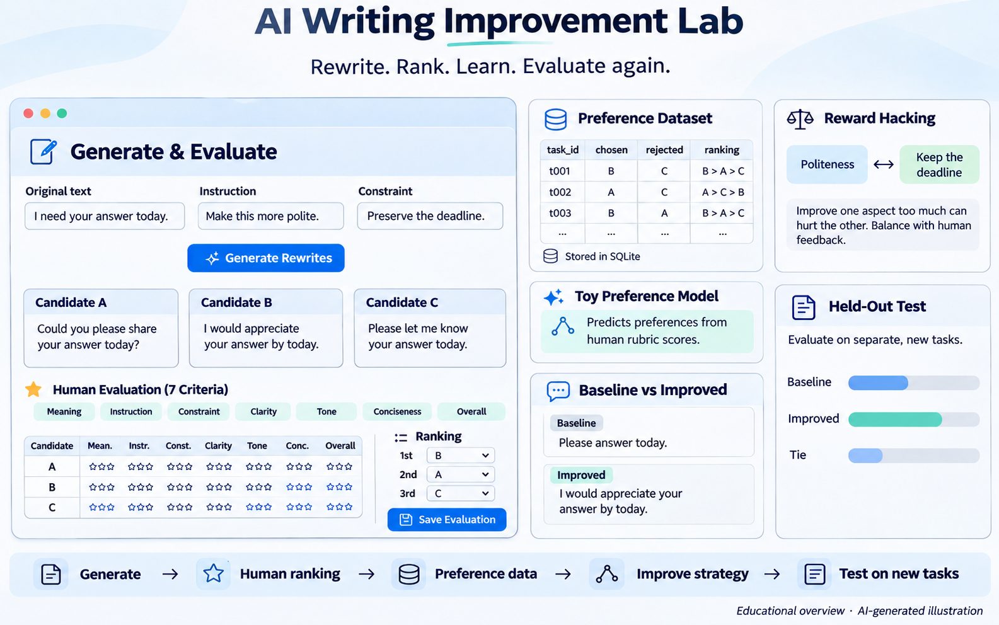

# AI Writing Improvement Lab

A beginner-friendly portfolio project for learning how human feedback can guide better AI writing. Generate three rewrites, score and rank them, collect preference data, then compare a basic generation strategy with a stronger one on separate tasks.



*AI-generated illustration of the application workflow; not a screenshot or measured experimental results. See the [generation prompts](docs/image-generation.md).*

This is an educational simulation. It does not perform SFT, PPO, production RLHF, or language-model weight updates. The original project brief is retained in `prompt.txt`.

## Problem and why human feedback matters

A rewrite can sound polite while changing the message. For example, replacing “today” with “whenever you have time” improves softness but loses a deadline. Human feedback makes that tradeoff explicit: what was preserved, what was lost, and which answer better satisfies the request.

A reviewed rewrite can serve as a **demonstration** of desired behavior. A ranking records **preferences** among alternatives. This lab collects rankings and ratings, explores a toy preference model, and tests a fixed prompt improvement. It does not automatically turn every preferred answer into a verified training example.

## Quick start

From the project folder on macOS/Linux:

```sh
python -m venv venv
source venv/bin/activate
pip install -r requirements.txt
cp .env.example .env
```

Edit `.env` and replace `your_api_key_here` with your OpenAI API key, then run:

```sh
streamlit run app.py
```

Use Python **3.11+**; development checks use **Python 3.12.6**. If `python` is unavailable before activation on macOS/Linux, use `python3 -m venv venv`. Windows commands and all settings are below.

## How the project works

1. Enter original text, a rewrite instruction, and optional constraints, or select a practice task.
2. Generate A, B, and C in independent OpenAI requests.
3. Score every candidate on seven criteria and rank all three exactly once.
4. Explain the top choice and flag an important constraint violation if present.
5. Save validated feedback in SQLite; inspect, filter, and export the dataset.
6. Analyze weak criteria, first-place rates, and constraint violations.
7. Explore a classifier that learns pairwise preferences from the human ratings.
8. Compare fixed baseline and improved prompting strategies on a development task.
9. Evaluate both strategies on a separate ten-task test library and review their win/tie rates.

This illustrates **evaluate → identify weakness → change instructions → evaluate again**. Better results must be measured; the label “improved strategy” describes its intended design, not a guaranteed outcome.

## Application pages

| Page | Purpose |
| --- | --- |
| Home | Learn the workflow, demonstrations, rankings, and limits of the simulation. |
| Generate & Evaluate | Use ten practice tasks or your own input; generate three rewrites, score, rank, and save feedback. |
| Dataset | Filter saved evaluations, inspect all details, and download CSV. |
| Analytics | Review first-place percentages, rubric averages, weak criteria, and violation rates with Matplotlib charts. |
| Preference Model | Inspect a simple rubric-based pairwise classifier and its held-out accuracy. |
| Improvement Experiment | Generate and judge baseline versus improved responses for a development task. |
| Improvement Test | Judge both strategies on ten separate built-in tasks and track baseline wins, improved wins, and ties. |
| Reward Hacking | Explore why rewarding politeness alone can favor a rewrite that loses the deadline. |
| Concepts | Read explanations of pretraining, post-training, SFT, demonstrations, feedback, preferences, RLHF, rewards, evaluation, held-out tests, hill climbing, and iterative improvement. |

## Architecture and project structure

```text
Original text + rewrite instruction + constraints
                       |
                Streamlit interface
                       |
              generation.py strategies
                       |
          openai_client.py → OpenAI Responses API
                       |
           independent candidate rewrites
                       |
          human scores + ranking + rationale
                       |
             validation → SQLite
                       |
       +---------------+----------------+
       |               |                |
   Dataset/CSV     Analytics      Preference model
                                     (rubric features)

Development experiment → fixed strategy → separate writing-task test
            baseline/improved judgments → comparison storage
```

Streamlit is both the browser interface and the Python application server. API calls, validation, storage, analytics, and model logic live in separate modules.

```text
Human-Feedback-Writing-Improvement-Lab/
├── app.py
├── pages/
│   ├── 1_Generate_and_Evaluate.py
│   ├── 2_Dataset.py
│   ├── 3_Analytics.py
│   ├── 4_Preference_Model.py
│   ├── 5_Improvement_Experiment.py
│   ├── 6_Improvement_Test.py
│   ├── 7_Reward_Hacking.py
│   └── 8_Concepts.py
├── src/
│   ├── __init__.py
│   ├── config.py
│   ├── openai_client.py
│   ├── generation.py
│   ├── evaluation.py
│   ├── database.py
│   ├── analytics.py
│   ├── preference_model.py
│   ├── sample_tasks.py
│   ├── experiments.py
│   ├── experiment_ui.py
│   └── ui.py
├── tests/
├── data/.gitkeep
├── docs/
│   ├── image-generation.md
│   └── images/application-overview.png
├── .streamlit/config.toml
├── .env.example
├── .gitignore
├── pytest.ini
├── requirements.txt
├── prompt.txt
└── README.md
```

## Technology stack

| Technology | Role |
| --- | --- |
| Python, Streamlit | Application logic and nine-page interface |
| Official OpenAI Python SDK | Text generation through the Responses API |
| Pandas, NumPy | Tables, summaries, and numerical features |
| SQLite | Local persistence; included with Python |
| Matplotlib | Analytics charts; no Seaborn |
| scikit-learn | Logistic regression and grouped train/test preparation |
| python-dotenv | Project-relative `.env` configuration |
| pytest | Unit and Streamlit workflow tests with mocked API calls |

The integration follows the [official OpenAI Python SDK documentation](https://developers.openai.com/api/reference/python). The configurable default model is [`gpt-4.1-mini`](https://developers.openai.com/api/docs/models/gpt-4.1-mini).

## Installation and API setup

Open a terminal in the project folder and create the environment:

```sh
python -m venv venv
```

Activate on macOS/Linux:

```sh
source venv/bin/activate
```

Activate in Windows Command Prompt:

```bat
venv\Scripts\activate
```

Or in Windows PowerShell:

```powershell
.\venv\Scripts\Activate.ps1
```

Install dependencies in the activated environment:

```sh
pip install -r requirements.txt
```

Copy the configuration once using `cp .env.example .env` on macOS/Linux, or the following in PowerShell:

```powershell
Copy-Item .env.example .env
```

Edit `.env`:

```dotenv
OPENAI_API_KEY=your_api_key_here
OPENAI_MODEL=gpt-4.1-mini
OPENAI_USE_TEMPERATURE=true
OPENAI_TEMPERATURE=0.7
OPENAI_MAX_OUTPUT_TOKENS=1024
WRITING_LAB_DB_PATH=data/writing_lab.db
```

Get your key from the [OpenAI API dashboard](https://platform.openai.com/api-keys). Never put the actual key in source code, screenshots, or Git. `.env` is ignored, and the application does not display the key. Without a usable key, generation is disabled with setup guidance; learning pages and saved datasets remain available.

Temperature accepts values from 0 to 2. Set `OPENAI_USE_TEMPERATURE=false` for a model that does not support that parameter. The output budget accepts integers from 64 to 16384; the chosen model may impose additional restrictions. Both experimental strategies use the same model, temperature configuration, and output budget.

Relative database paths resolve from the project folder. Settings are reread from its `.env` file, with existing process environment variables taking priority. A fresh database is initialized automatically and contains no preloaded synthetic judgments.

## Usage and generation behavior

Run `streamlit run app.py`, open the local URL printed in the terminal, and navigate with the sidebar. Stop with `Ctrl+C`.

Start with the “Polite deadline” practice task. Read each rewrite, review all rubric sliders, rank A/B/C without duplicates, and explain the top choice. Sliders begin at 3 as a starting value, not a model-generated score. Save before closing the browser session; unfinished drafts are session-only. If you edit the task after generation, regenerate or restore the original input before saving its responses.

Candidate generation normally makes three independent generation calls. A uses direct phrasing, B considers another structure, and C favors concise wording when compatible with the task. Every request includes the original, instruction, and constraints; no candidate receives another's output. A duplicate B or C gets one independent retry. Persistent duplicates or failed/incomplete output produce an error rather than fabricated or partial candidates.

Strategy comparisons use two independent calls and allow identical answers: a tie is a valid result. The SDK can retry eligible request failures once, so HTTP attempts can exceed the normal three candidate calls or two strategy calls. Generating sends the task to OpenAI and can incur charges. The application requests `store=False`; this is not a claim that the provider retains no operational data.

## Evaluation rubric and preference data

Score each candidate from **1 (poor)** to **5 (excellent)**:

| Criterion | Question |
| --- | --- |
| Meaning Preservation | Does the rewrite retain the important meaning? |
| Instruction Following | Does it perform the requested transformation? |
| Constraint Following | Does it respect explicit restrictions? |
| Clarity | Is it easy to understand? |
| Tone | Does it have the requested tone? |
| Conciseness | Is it appropriately concise? |
| Overall Quality | How successful is the rewrite overall? |

A complete evaluation stores a UUID, UTC timestamp, original text, instruction, constraints, all three candidates, 21 rubric scores, first/second/third place, rationale, and a constraint-violation flag/explanation. Rankings must contain A, B, and C exactly once. Validation checks required fields and scores before saving, and repeat saves of the same ID do not duplicate feedback.

Only one candidate can be selected in the constraint-violation flag. Mention additional violations in its explanation. Analytics count **evaluations with a flag**, so the violation rate is not the fraction of all individual candidate responses that violated a constraint. The weak criterion is the lowest mean rating, with ties reported together.

Strategy comparisons are stored separately from three-candidate rankings, including both responses, the preferred strategy or tie, and task/protocol information. They are not added to the preference classifier's ranking dataset.

Dataset filters and dates use UTC. CSV exports include the filtered records; text that could be interpreted as a spreadsheet formula receives an apostrophe prefix in the export. SQLite values remain unchanged. The local database is excluded from Git; back it up separately if you want to retain feedback.

## Preference-model explanation

For a ranking **A > C > B**, construct three preferences: A over C, A over B, and C over B. Each pair uses the seven rubric-score differences as features. Reversing a pair negates its features and label; these mirrored rows provide both classifier classes but are not new human judgments.

The demo requires at least **eight distinct complete evaluations**. It first splits whole evaluation IDs **75%/25%**, then expands rankings and mirrors pairs independently inside each split. All pairs from one ranking stay together, avoiding leakage between its training and held-out rows. Logistic regression is fitted on training pairs; accuracy is measured on held-out pairs. The interface distinguishes original preference-pair counts from mirrored training rows.

Positive coefficients associate higher left-versus-right scores with preference for the left candidate. They do not establish causation or objective criterion importance. Predictions require human ratings and do not read response text.

**This is a simplified educational preference model, not a production RLHF reward model.** Its held-out ranking rows test the classifier; they are different from the ten held-out writing tasks described below.

## Baseline versus improved experiment

The baseline receives a minimal instruction to rewrite the supplied request. The improved **v1** prompt emphasizes meaning preservation, every explicit constraint, requested tone, no unsupported facts or promises, and a final constraint check before returning only the rewrite.

Both receive the same original text, rewrite instruction, and constraints. Only their strategy instructions differ; neither sees the other's response. No examples from the held-out task library are injected into these prompts. Use development feedback to understand the targeted weakness, then evaluate the fixed strategy without revising it after inspecting test results.

## Held-out Improvement Test

The test library contains **ten tasks distinct from the practice examples**, covering cases such as library notices, museum photography rules, maintenance windows, and tentative delivery estimates. Evaluate baseline and improved responses, choose a winner or tie, and inspect baseline/improved/tie rates among saved eligible judgments.

Tasks whose original text already appears in the development ranking dataset or development strategy comparisons are excluded from the clean test results. This check detects recorded reuse, not outside exposure or all paraphrases. Once a test example influences your strategy, it is no longer untouched evidence for that revised strategy.

The database keeps the **first saved judgment for each held-out task ID**, preventing repeated attempts from replacing an earlier result. This release supports protocol `v1` only. A new protocol requires updates to the generation/version constants, record validation, and SQLite schema, alongside fresh task IDs and a separate database. Keep model and sampling settings fixed throughout a test; comparison records do not currently include a model/settings fingerprint. Ten subjective judgments illustrate a method, not a reliable performance claim.

## Reward-hacking demonstration

The interactive example contrasts politeness-only scoring with a score that also values meaning and constraint following. “Whenever you have a chance…” can score well for politeness while losing the required deadline. Adjust the scoring weights to see the tradeoff. Optimizing an incomplete metric can improve its score while making the actual task worse; this does not require conscious cheating by the model.

## Development, tests, and publishing

From the activated environment:

```sh
python -m pytest
python -m compileall -q app.py src pages
streamlit run app.py
```

Tests cover validation, ranking rules, database behavior, CSV export, generation isolation/errors, preference-pair construction and split integrity, analytics, and Streamlit workflows. API responses are mocked; tests need no key, make no paid calls, and do not verify a live API account or model connection.

After reviewing changes, publish from the repository folder:

```sh
cd /Users/sreytouch/Desktop/Human-Feedback-Writing-Improvement-Lab
python -m pytest
git status --short
git diff --check
git add app.py pages src tests data/.gitkeep docs .streamlit/config.toml .env.example .gitignore pytest.ini requirements.txt README.md prompt.txt
git diff --cached --stat
git commit -m "Build AI Writing Improvement Lab"
git push origin main
```

The configured remote is [sreytouch/Human-Feedback-Writing-Improvement-Lab](https://github.com/sreytouch/Human-Feedback-Writing-Improvement-Lab). Review staged files before committing; credentials, databases, and virtual environments belong outside Git. Pushing the repository does not deploy the Streamlit app.

## Troubleshooting

| Symptom | What to check |
| --- | --- |
| Generation is disabled | Create the project `.env`, replace the API-key placeholder, and rerun the page. |
| API authentication or rate error | Check the key, API account access, billing, and usage limits. |
| Model/parameter error | Verify `OPENAI_MODEL`; disable temperature for unsupported models and check the output budget. |
| Cannot open or save the database | Make sure `WRITING_LAB_DB_PATH` names a SQLite file in a writable folder. |
| Save is blocked | Complete every score, use each rank once, add a rationale, and ensure the input still matches the generated task. |
| Preference model cannot train | Collect at least eight complete rankings; repeated clicks on one saved evaluation do not add examples. |
| Test task is excluded or already saved | Check development-task reuse and the first-judgment rule. A new protocol requires code/schema updates as well as fresh tasks and storage; this release supports `v1`. |
| `streamlit` or an import is missing | Activate `venv` and rerun `pip install -r requirements.txt`; launch from the project folder. |

## Limitations and future improvements

The app is local and has no authentication or per-user isolation. A/B/C and baseline/improved labels are visible, so position and expectation bias can influence judgments. Small subjective datasets, repeated or similar prompts, and incomplete contamination detection limit generalization. The preference model uses ratings rather than language understanding; no training process changes the generating LLM. Live API behavior is not verified by the offline test suite.

Useful next steps include blinded/randomized comparisons, multiple evaluators and agreement measures, model/settings fingerprints, prompt-grouped larger test sets, multiple violation flags, reviewed demonstration exports, and authentication/storage migrations for a shared deployment. Any new strategy should receive a new protocol and genuinely new evaluation tasks.
